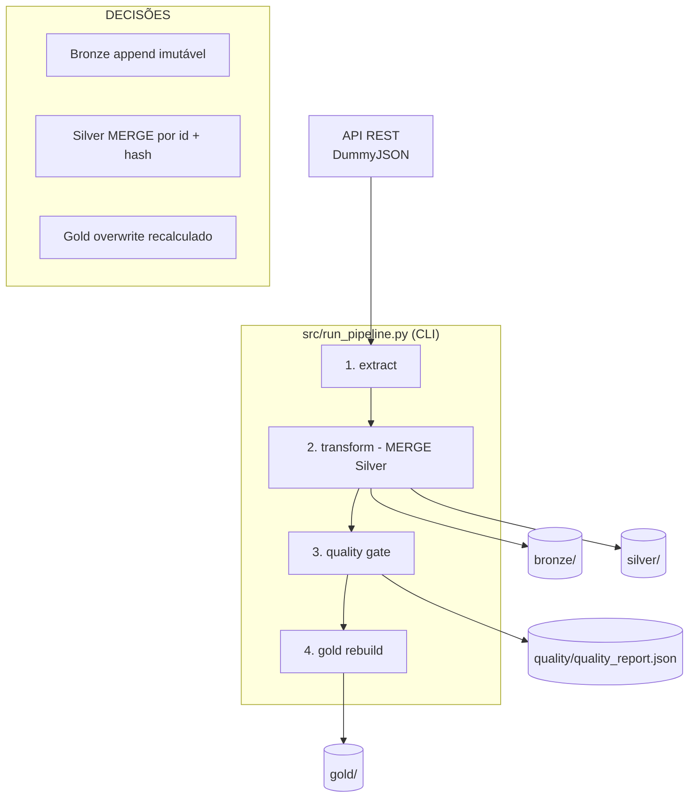

# Arquitetura — Medallion Data Pipeline

## Visão geral

## Contratos de dados

### Entrada — API (contrato de origem)

| Endpoint | Chave | Campos usados | Notas |
|---|---|---|---|
| `/products` | `id` | title, description, category, price, discountPercentage, rating, stock, brand | paginado limit/skip |
| `/carts` | `id` | userId, total, discountedTotal, products[] (id, title, quantity, price, discountedPrice) | 1 pedido N itens |
| `/users` | `id` | firstName, lastName, email, phone | base de clientes |

### Bronze (contrato interno — append-only)

| Campo | Tipo | Origem |
|---|---|---|
| `record_id` | string (md5) | hash determinístico de `source + id` |
| `source_endpoint` | string | products / carts / users |
| `record_pk` | string | `id` do registro na API |
| `payload` | string (JSON) | registro cru serializado |
| `batch_id` | string (uuid4) | lote de execução |
| `ingested_at` | timestamp | hora UTC da ingestão |

### Silver (contrato de consumo interno)

- Uma tabela por fonte (`silver.products`, `silver.carts`, `silver.users`), colunas snake_case tipadas + `_hash` (md5 do payload) + `updated_at`.
- **MERGE por `id`**: `whenNotMatched` -> insert; `whenMatched` e `_hash` diferente -> update; senão, nenhum comando (sem reescrita desnecessária).

### Gold (contrato de consumo analítico)

| Tabela | Chave | Métricas |
|---|---|---|
| `dim_produto` | `id` | preço, rating, estoque, desconto |
| `fato_pedido_item` | `pedido_id` + `produto_id` | quantidade, receita item |
| `agg_vendas_categoria` | `categoria` | receita, itens, pedidos, rating médio |
| `agg_kpis_gerais` | linha única | receita total, ticket médio, contagens |

## Decisões de arquitetura

1. **Por que manter o payload cru no Bronze?** Reprocessamento sem nova chamada à API, auditoria ("o que chegou de fato?") e time travel Delta para comparação entre lotes.
2. **Por que MERGE no Silver em vez de overwrite?** Carga incremental real: só o que mudou é escrito; histórico preservado; idempotência garantida (base para cargas horárias/diárias em produção).
3. **Por que Gold com overwrite?** Agregações derivadas: mais barato recalcular do que manter incremental — decisão clássica em camadas de serving.
4. **Quality gate entre transform e gold:** Gold só é recalculada depois da Silver passar por todas as regras críticas — consumidores nunca veem dados não validados.
5. **Schema explícito no `from_json`:** evolução da API sem quebra silenciosa; campos novos são ignorados, campos removidos viram null audível.

## Regras de qualidade (resumo)

| Regra | Tabela | Severidade |
|---|---|---|
| Chave primária nula | silver.* | crítica |
| Duplicidade de chave | silver.* | crítica |
| `price < 0` | silver.products | crítica |
| `total` divergente da soma dos itens | silver.carts | warning (tolerância 0,05) |
| Item de pedido sem produto no catálogo | gold (fato x dim) | crítica |
| KPIs zerados pós-carga | gold | crítica |

Relatório por execução: `data/lakehouse/quality/quality_report.json`.
